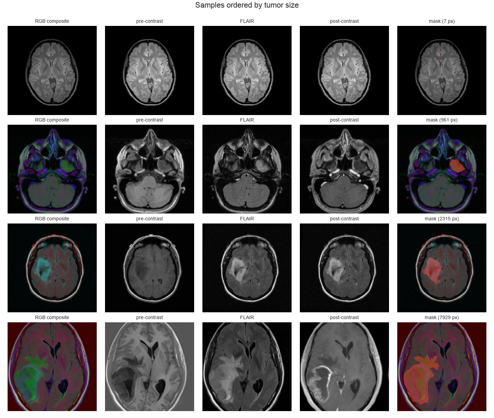
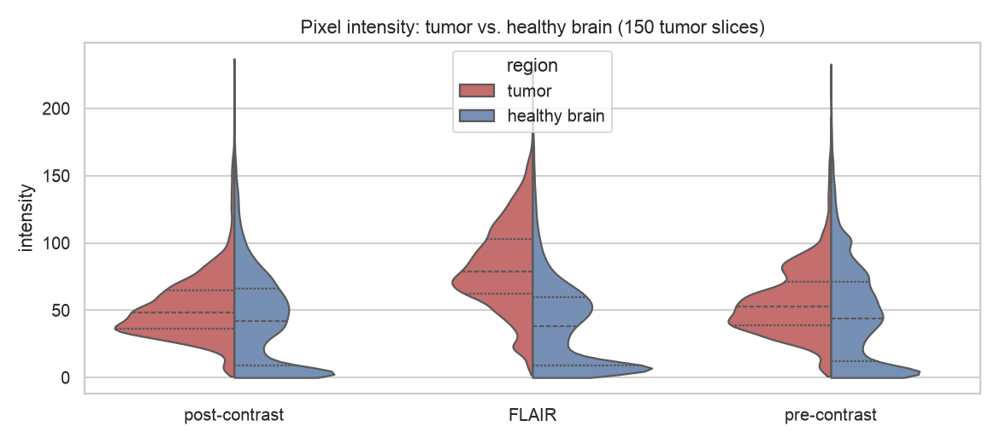
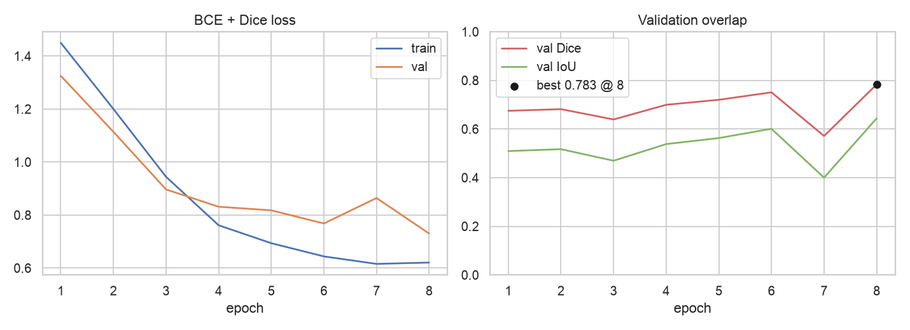
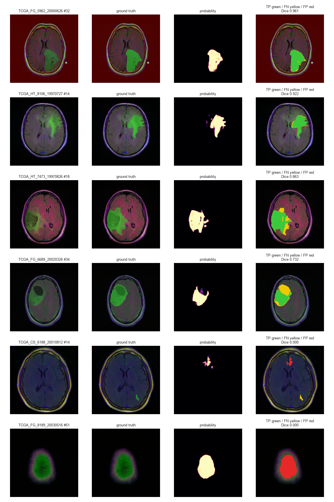
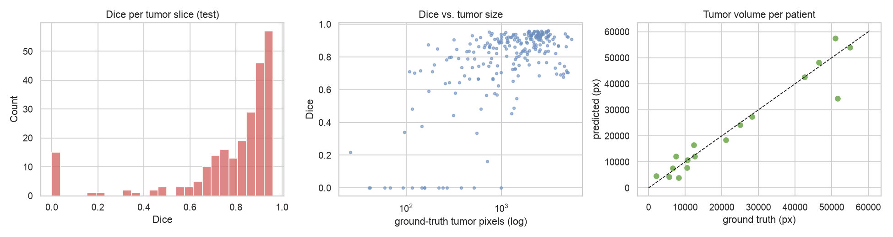

# Brain MRI Tumor Segmentation — Project Report

## 1. Problem

Lower-grade gliomas (LGG) show up as a hyperintense region on the FLAIR MRI sequence. Outlining that region by hand
slice by slice is slow and varies between readers. The goal is a computer-vision model that, for each axial MRI slice,
(1) decides whether a tumor is present and (2) produces a pixel-level segmentation mask.

## 2. Dataset

**LGG MRI Segmentation** (Kaggle `mateuszbuda/lgg-mri-segmentation`; Buda et al., 2019). TCGA/TCIA data:

| | |
|---|---|
| Patients | 110 |
| Slices | 3,929 (256×256, TIFF) |
| Slices with tumor | 1,373 (34.9 %) |
| Slices per patient | 20 / 33 / 88 (min / median / max) |
| Tumor pixels per slice | median 1,529, P10 314, P90 4,152 |
| Foreground ratio (all pixels) | 1.03 % |

Each slice has 3 channels: **pre-contrast, FLAIR, post-contrast**. For 9 patients the post-contrast and for 6 the
pre-contrast sequence is missing and was replaced by FLAIR (verified: 10 patients have duplicated channels).
The archive was fetched from a Hugging Face mirror of the Kaggle archive because no Kaggle API key was configured;
`scripts/prepare_data.py` uses the Kaggle API when one is available.

### Data cleaning (`bmts/data.py`, `results/cleaning_report.json`)

* The archive ships the dataset twice (`kaggle_3m/` and `lgg-mri-segmentation/kaggle_3m/`); duplicates were removed on (patient, slice).
* Checks: readable image + matching mask, 256×256 size, non-blank image, binary mask values.
  All 3,929 slices passed, so nothing was dropped.

### Split

**Patient-level** split (no slices of one patient in two sets), stratified on each patient's share of tumor slices, seed 42:

| Split | Patients | Slices | Tumor slices |
|---|---|---|---|
| train | 76 | 2,584 | 898 |
| val | 17 | 664 | 235 |
| test | 17 | 681 | 240 |

A slice-level random split would leak neighbouring, near-identical slices into the test set and inflate scores.

## 3. Exploratory analysis (`scripts/eda.py`)



* **Class imbalance** at two levels: 65 % of slices contain no tumor, and inside tumor slices the tumor covers ~3 %
  of pixels on average (`eda_class_balance.png`, `eda_tumor_size.png`).
* **Tumor size** spans more than two orders of magnitude (from a few to ~8,000 pixels; log-scale histogram).
* **Slice position**: tumors mostly appear in the middle of the volume; the top and bottom slices are rarely positive
  (`eda_slice_position.png`).
* **Intensity**: FLAIR separates tumor from healthy brain best (tumor median ≈ 80 vs. ≈ 40 for healthy tissue);
  pre/post-contrast overlap heavily, which matches the masks being drawn on FLAIR (`eda_intensity.png`).



## 4. Method

### Preprocessing (`bmts/preprocess.py`)
* Per-image, per-channel **z-score over brain pixels** (background excluded). MRI intensities are not calibrated across
  scanners, so a fixed /255 scale would leave large patient-to-patient brightness shifts.
* Augmentation (train only, applied identically to image and mask): horizontal flip, rotation ±15°, scale 0.9–1.1,
  shift ±6 %, brightness/contrast and gamma jitter.

### Model (`bmts/model.py`)
**U-Net** (4 down / 4 up levels, 32→512 channels, BatchNorm, dropout 0.1 in the deepest blocks), 7.76 M parameters,
1-channel sigmoid output.

### Training (`scripts/train.py`)
* Loss: **BCE + soft Dice**. BCE alone is dominated by the 99 % background pixels; Dice targets overlap directly.
* Tumor slices oversampled ×2 (weighted sampler) so batches contain enough foreground.
* AdamW (lr 1e-3, wd 1e-4), One-Cycle schedule, batch 16, Apple M-series GPU (MPS).
* Checkpoint picked by best validation Dice.

**Time budget.** Training was cut short because of a hard time limit: 5 epochs of the planned 30 at lr 1e-3, then
3 fine-tuning epochs at lr 3e-4 from the epoch-5 checkpoint (8 epochs, ~15 minutes in total).
The best checkpoint is from epoch 8 (val Dice 0.783).



The validation curve is still rising and noisy (epoch 7 drops to 0.57), so the model **has not converged**. Longer
training is the most obvious improvement (see §7).

### Post-processing (`scripts/evaluate.py`)
Probability threshold and minimum connected-component area were tuned on the **validation** set only
(grid 0.3–0.7 × 0–100 px, criterion: mean per-slice Dice), then applied unchanged to test.
Selected: **threshold 0.7, min area 100 px**. Inference averages the prediction with its horizontal flip (TTA).

## 5. Results (test set, 17 unseen patients, 681 slices)

| Metric | U-Net (thr 0.5) | + post-processing |
|---|---|---|
| **Dice (global, pixel level)** | 0.814 | **0.822** |
| IoU (global) | 0.686 | 0.698 |
| Mean Dice, tumor slices | 0.778 | 0.774 |
| Mean Dice, all slices (empty = 1 if predicted empty) | 0.779 | **0.840** |
| Mean Dice per patient (3D) | 0.768 | 0.776 |
| Pixel precision / recall | 0.791 / 0.839 | 0.833 / 0.811 |
| Detection accuracy (slice has tumor?) | 0.841 | **0.900** |
| Detection sensitivity | 0.954 | 0.946 |
| Detection specificity | 0.780 | **0.875** |

Post-processing mostly removes small false-positive blobs on healthy slices: specificity rises from 0.78 to 0.88 at a
cost of 0.8 points of sensitivity.



### Error analysis

Dice by tumor size (tumor slices of the test set):

| GT tumor area (px) | Slices | Mean Dice |
|---|---|---|
| < 500 | 45 | 0.50 |
| 500–1,500 | 81 | 0.78 |
| 1,500–4,000 | 101 | 0.89 |
| > 4,000 | 13 | 0.79 |

* **Small tumors are the main weakness.** Slices with tumors under 500 px (the first/last slices of a lesion) average
  Dice 0.50; part of this comes from the 100 px minimum-area filter, which deletes very small true lesions.
* **Boundaries**: most remaining misses (yellow in the error map) are on the faint tumor edge, where FLAIR
  hyperintensity fades gradually and the manual annotation is itself uncertain.
* **Per patient**: the worst test patient (TCGA_CS_6188) has Dice 0.40; the model predicts ~2× the true volume there.



For reference, Buda et al. (2019) report a mean per-patient Dice of ~0.82 on this dataset with a U-Net trained much
longer; this model reaches 0.78 after 8 epochs.

## 6. Web application (`app.py`)

Streamlit app (`streamlit run app.py`): select a held-out test slice or upload an image, view the probability heatmap
and mask overlay, adjust threshold / minimum area / TTA, see Dice-IoU-precision-recall and a TP/FN/FP error map when a
ground-truth mask is given, and download the predicted mask. The model and 16 sample slices are stored in the repo,
so the app runs without the dataset (also on Streamlit Community Cloud).

## 7. Limitations and next steps

* **Train longer** (30–50 epochs): validation Dice was still climbing at epoch 8.
* Size-aware post-processing (lower min-area, or a separate tumor/no-tumor classifier head) to recover small lesions.
* Pretrained encoder (e.g. ResNet-34 U-Net) and 2.5D input (neighbouring slices as extra channels).
* 5-fold cross-validation by patient, since 17 test patients give noisy per-patient estimates.
* Educational project. Not validated clinically and not for diagnosis.

## Reproduce

```bash
python scripts/prepare_data.py && python scripts/eda.py
python scripts/train.py --epochs 30            # was stopped after epoch 5 here; recommended: let it finish
python scripts/train.py --init models/unet_best.pt --epochs 3 --lr 3e-4   # what was run here
python scripts/evaluate.py && python scripts/export_samples.py
streamlit run app.py
```
